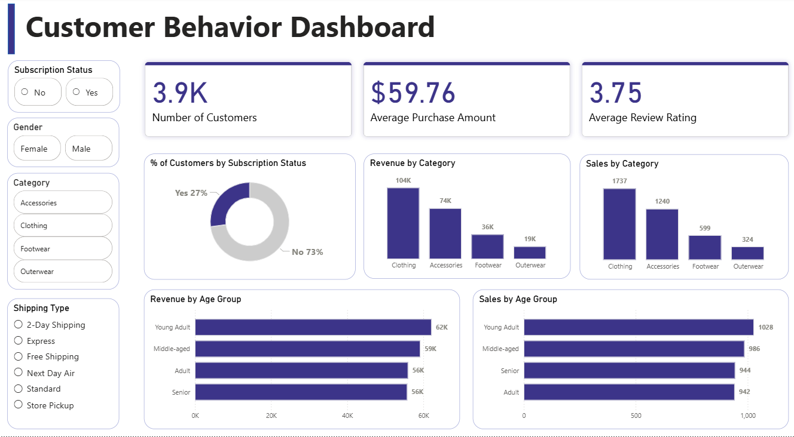

# Customer Shopping Behavior Analysis

## Objective

Analyze customer shopping behavior to identify spending patterns, customer segments, product preferences, and factors influencing purchasing decisions.

---

## Overview

This project uses Python, MySQL, and Power BI to analyze retail customer transaction data. The project covers data cleaning, feature engineering, SQL-based business analysis, and dashboard development to generate business insights.

---

## Business Problem

A retail company wants to better understand customer purchasing behavior across demographics, product categories, and shopping preferences. The goal is to identify trends that can improve customer engagement, marketing effectiveness, and sales performance.

---

## Dataset

- Records: 3,900
- Features: 18
- Customer Demographics:
  - Age
  - Gender
  - Location
  - Subscription Status
- Purchase Information:
  - Item Purchased
  - Category
  - Purchase Amount
  - Season
- Shopping Behavior:
  - Previous Purchases
  - Review Rating
  - Discount Applied
  - Shipping Type
  - Frequency of Purchases

---

## Tools & Technologies

- Python
  - Pandas
  - NumPy
  - Matplotlib
  - Seaborn
- MySQL
- Power BI
- Git & GitHub

---

## Analysis Workflow

### Python
- Data cleaning and preprocessing
- Missing value handling
- Feature engineering
- Customer segmentation
- Exploratory Data Analysis (EDA)

### MySQL
- Revenue analysis
- Customer loyalty analysis
- Subscription analysis
- Product performance analysis
- Discount behavior analysis

### Power BI
- Interactive dashboard creation
- KPI monitoring
- Customer behavior visualization

---

## Key Insights

- Young Adult customers generated the highest revenue among all age groups.
- Clothing emerged as the highest revenue-generating product category.
- Non-subscribers contributed the majority of total revenue due to their larger customer base.
- Loyal customers represented the largest customer segment based on previous purchase history.
- Repeat buyers were not necessarily more likely to be subscribers, indicating a weak relationship between loyalty and subscription status.
- Certain products exhibited significantly higher discount purchase rates, indicating stronger dependence on promotional discounts.
---

## Power BI Dashboard

The dashboard provides interactive analysis of:

- Total Customers
- Average Purchase Amount
- Average Review Rating
- Revenue by Category
- Sales by Category
- Revenue by Age Group
- Sales by Age Group
- Subscription Status Distribution

---

### Dashboard Preview

---

## Business Recommendations

- Promote subscription benefits to increase customer adoption.
- Strengthen loyalty programs for repeat customers.
- Optimize discount strategies to balance sales growth and profitability.
- Focus marketing campaigns on high-revenue customer segments.
- Promote top-rated and frequently purchased products.

---

## Author

**Arshiya Roofi Shaik**

- Contact: arshiyaroofi@gmail.com
- GitHub: [Arshiya-Roofi](https://github.com/Arshiya-Roofi)